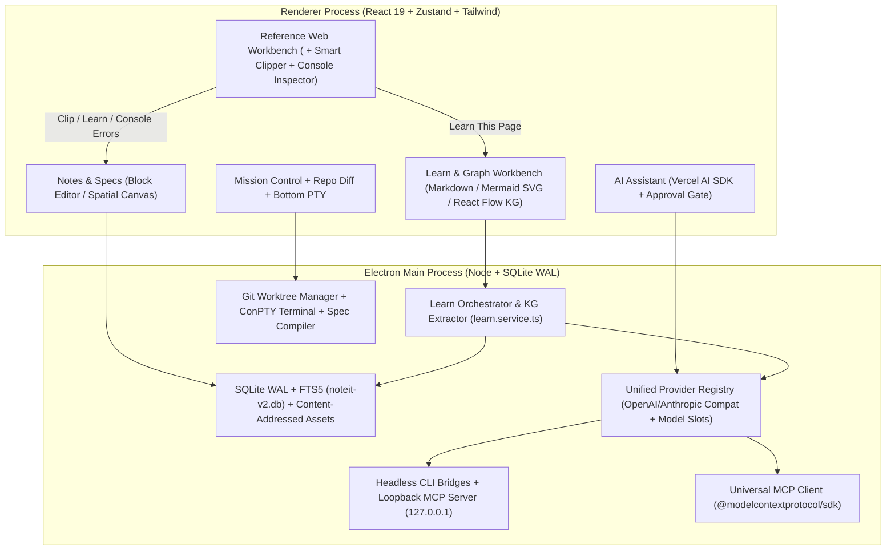

# NoteIT — Offline-First Engineering, ADE & Learning Workbench

**NoteIT** is a local-first desktop workbench built with **Electron 35, React 19, TypeScript, and SQLite WAL + FTS5**. It unifies structured engineering notes, offline diagramming, project planning, hybrid AI coding agents, an integrated reference browser, and an active learning workbench with a propositional knowledge graph—all backed by a single local SQLite database.

---

## Core Pillars

### 1. Structured Notes, Diagrams & Project Databases
- **Dual-Mode Pages**: Switch any page between **Block Document** mode and **Spatial Canvas** mode (`@xyflow/react`).
- **v2.5 Writing Experience**:
  - **Obsidian-Style Pure Live Preview**: Unfocused text blocks (`paragraph`, `callout`, `checklist`, `toggle`) render cleanly as formatted Markdown + inline `$KaTeX$` math + clickable `[[WikiLinks]]` / `[[src/file.ts#L42]]`, switching to auto-grow raw editing on click or keyboard navigation.
  - **Notion-Style Keyboard Flow & Markdown Auto-Shortcuts**: Type `# `, `## `, `### `, `[] `, `- [ ] `, `> `, `---`, ```` ```ts ````, or `$$ ` at the start of a block to auto-convert; `Enter` / `Shift+Enter` split/newline flow, `Backspace` merge/delete, `ArrowUp`/`ArrowDown` cross-block focus, `Ctrl+D` duplicate, **Turn Into** block conversion, and **Smart Markdown Paste** (single undo step + `Ctrl+Shift+V` raw paste).
  - **Offline KaTeX Math & Interactive GFM Tables**: Dedicated `math` block (`/math`, display LaTeX with Preview/Split/TeX modes, on-demand KaTeX lazy loading) and `table` block (`/table`, Tab/Enter cell navigation, alignment cycling, canonical GFM Markdown stored in `block.content` for FTS5 & export).
  - **CodeMirror 6 Code Blocks**: Syntax-highlighted code blocks (TS/JS, Python, SQL, JSON, HTML, CSS, Markdown, Bash) with language picker, line numbers toggle, Tab indent, and one-click Copy.
- **100% Offline Engineering Diagrams**:
  - **DBML Studio**: Real-time ERD rendering, draggable table layouts persisted in SQLite, foreign-key highlighting, and SQL DDL export.
  - **Mermaid Studio**: Dynamic lazy-loaded rendering with strict SVG sanitization (`svg-sanitize.ts`).
  - **Graphviz DOT**: Offline WebAssembly rendering (`@viz-js/viz`).
- **Project Database Block**: Five synchronized views over local tasks—**Gantt** (pointer-capture bar drag & keyboard nudge), **Kanban** (drag-and-drop columns), **Table**, **Calendar**, and **Charts** (`recharts`: bar, line, area, donut, radar, scatter).
- **Durability First**: SQLite WAL mode, FTS5 full-text search triggers, ID-based bi-directional WikiLinks (`[[Page]]`) + code links (`[[src/file.ts#L42]]`), per-page undo/redo, version snapshots with block-level diff, incremental `VACUUM INTO` backups, and full Markdown + asset export.
- **Fast Capture**: Global **Quick Capture** (`Ctrl+Shift+Space` → Inbox) and **Daily Notes** (`Ctrl+Alt+D` → `YYYY-MM-DD`).

### 2. Unified AI Provider Registry & Zero-API-Key CLI Bridges
- **Zero-API-Key External CLI Bridges**: Reuse CLIs already signed in on your machine (**Claude Code**, **Gemini CLI**, **Codex CLI**, or custom CLIs like **Antigravity `agy`**) without paying for separate API keys.
  - Claude Code connects through a **token-protected loopback MCP server** (`127.0.0.1`) so NoteIT retains control over workspace tools, approvals, and credentials while stripping NoteIT-stored keys from the child environment.
- **Custom OpenAI-Compatible & Anthropic-Compatible Endpoints**: Connect OpenRouter, DeepSeek, Groq, vLLM, LiteLLM, LM Studio, MiniMax, GLM, or any custom proxy with custom Base URLs, dynamic Model IDs, and encrypted OS keychain secrets (`safeStorage`).
- **AI Studio Side-by-Side Split Pane & Block-to-AI Actions (v2.5)**:
  - Open **AI Studio** (Chat, Active Learn, Knowledge Graph) side-by-side next to your active note (`Ctrl+Alt+C` or **AI Split** in page header) using the same resizable split divider, with one-click Pop-out to full view.
  - Trigger **Block-to-AI** from any block's Sparkles menu, floating text-selection toolbar, or `/ai` slash command (`Ask`, `Explain simply`, `Improve & tighten`, `Turn into diagram`, `Learn this block`), and apply AI replies back into your note via **Insert after block**, **Replace block**, or **Append to page** with automatic Markdown-to-Blocks parsing (single `Ctrl+Z` undo).
- **Model Slots**: Separate **Primary** (AI Chat & Learn Tutor) and **Background** (Knowledge Graph Extraction) model slots.
- **Agentic Development Environment (ADE)**:
  - **Agent Mission Control**: Bind repositories to Notebooks/Sections, compile `.noteit/` spec bundles, and dispatch CLI agents into isolated **Git Worktrees** (with NTFS junction bootstrap for `node_modules`/`.venv`).
  - **Code & Diff Inspector**: CodeMirror 6 + `@codemirror/merge` viewer with hunk-level inspection and worktree merge/discard.
  - **Bottom PTY Terminal Multiplexer**: `@lydell/node-pty` (ConPTY) + `@xterm/xterm` with WebGL acceleration and graceful `child_process` fallback.
  - **Universal MCP Client**: Connect external `stdio`, `SSE`, or `streamable-http` MCP servers directly to In-App AI Chat with an Approval Gate (`ask`, `auto-edit`, `plan-only`).

### 3. Web Workbench (In-App Reference Browser)
- Persistent Chromium partition (`persist:noteit-browser`) and persisted tabs across restarts.
- Editable global & per-notebook bookmarks, popup-to-tab handling, **Find-in-Page (`Ctrl+F`)**, zoom controls, and configurable omnibox search engine (default **Google**, switchable to Bing, Brave, or DuckDuckGo in **Settings → Browser**).
- **Smart Markdown & Code-Block Clipper**: Extracts structured headings, paragraphs, lists, and fenced code blocks straight into the active NoteIT page.
- **Localhost Console Inspector**: Captures `<webview>` warnings/errors and lets you send stack traces straight to AI Chat, plus a one-click **Learn** button to study any open docs page.

### 4. Learn & Graph Workbench
Inspired by [LearnHarness](https://github.com/amosblomqvist/learnharness), integrated natively into NoteIT's SQLite store and React Flow canvas:
- **4-Phase Pedagogical Loop**: **1. Measure (Probe)** → **2. Plan (Live Mermaid DAG)** → **3. Teach (Step-by-step + Check)** → **4. Practice (Transfer Problems)**.
- **Think Out Loud & Confidence Rating**: Capture your reasoning alongside answers with `1 Guessed`–`5 Solid` confidence tracking.
- **Non-Blocking Side Questions**: Highlight any passage in a lesson and ask quick clarifying questions in a side thread without interrupting the active step.
- **Propositional Knowledge Graph**: Extract objective propositions and jointly-entailing reasoning chains from lessons or NoteIT pages into an interactive `@xyflow/react` graph with deterministic deduplication and backlinks to source pages/sessions.
- **Two-Way NoteIT Bridge**: Launch lessons from any NoteIT page (`Learn` in page header) or web page, and **Crystallize** completed lessons back into structured NoteIT pages.

---

## Architecture Overview



---

## Getting Started

### Prerequisites
- **Node.js** 22+ (uses built-in `node:sqlite`)
- **Git** (for ADE Repo Explorer & Git Worktree isolation)
- *(Optional)* Any already-authenticated CLI in `PATH` (`claude`, `gemini`, `codex`, or `agy`) for Zero-API-Key AI features.

### Commands

```bash
# Install dependencies
npm install

# Start Electron + Vite in development mode
npm run dev

# Run TypeScript checks (Node + Web)
npm run typecheck

# Run full Vitest unit test suite
npm test

# Build production bundles (main, preload, renderer)
npm run build

# Package Windows desktop build
npm run dist:win
```

### Configuring AI Providers (Zero-API-Key or Custom Endpoints)
1. Open **Settings → AI providers & CLI bridges**.
2. **Zero-API-Key CLI**: Click **Check again** under *Zero-API-Key External CLI Bridges* and select **Use CLI** on any detected CLI (`Claude Code CLI`, `Gemini CLI`, `Codex CLI`, or `Antigravity CLI`).
3. **Custom OpenAI / Anthropic Endpoints**: Click **Add endpoint**, pick `OpenAI-Compatible API (/v1)` or `Anthropic-Compatible API (Messages)`, enter your Base URL, Default Model ID, and optional API key (encrypted via Electron `safeStorage`), then click **Test**.
4. **Model Slots**: Assign a **Primary** slot for Chat/Learn and a fast/cheap **Background** slot for Knowledge Graph extraction.

---

## Key Shortcuts

| Shortcut | Action |
| :--- | :--- |
| `Ctrl+K` | Open Command Palette & SQLite FTS5 Search |
| `Ctrl+Shift+Space` | Global Quick Capture → Inbox |
| `Ctrl+Alt+D` | Open / Create Today's Daily Note (`YYYY-MM-DD`) |
| `Ctrl+Shift+C` | Toggle AI Assistant (Full View) |
| `Ctrl+Alt+C` | Toggle AI Studio Split Pane (Side-by-Side) |
| `Ctrl+Shift+A` | Toggle Agent Mission Control |
| `Ctrl+Shift+B` | Toggle Reference Web Workbench |
| `` Ctrl+` `` | Toggle Bottom PTY Terminal Drawer |
| `Ctrl+\` | Collapse / Expand Sidebar |
| `Ctrl+F` *(in Browser)* | Find in Page |

---

## Documentation Index

- **[docs/ROADMAP.md](docs/ROADMAP.md)** — Product roadmap, locked decisions, and release milestones (v2.1 → v2.3).
- **[docs/DESIGN.md](docs/DESIGN.md)** — *Obsidian Studio* & *Archival Vellum* design system, color tokens, and semantic icon palette.
- **[docs/ADE.md](docs/ADE.md)** — Hybrid Agentic Development Environment & v2.3 Provider/CLI Bridge architecture.
- **[docs/LOG-v2.3.md](docs/LOG-v2.3.md)** — Engineering work log for v2.3 (Providers, Web Workbench, Learn & Graph, and bugfixes).
- **[docs/LOG-v2.2.md](docs/LOG-v2.2.md)** — Historical work log for v2.2 (*Unfreeze 7 Fitur*).
- **[docs/PRD.md](docs/PRD.md)** — Original v2.0 Product Requirements Document.
- **[docs/TIPTAP-SPIKE-REPORT.md](docs/TIPTAP-SPIKE-REPORT.md)** — Historical spike report evaluating Tiptap migration.
