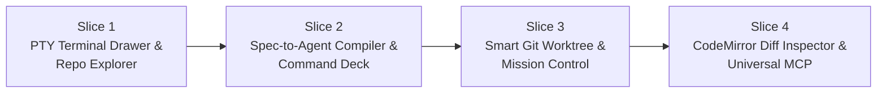

# NoteIT ADE & AI Agent Workbench — Master Implementation Plan

> **Dokumen Terkait**:
> - [`docs/ADE.md`](./ADE.md) — Master Architecture Blueprint
> - [`docs/DESIGN.md`](./DESIGN.md) — Precision Engineering Design System
> - [`docs/PRD.md`](./PRD.md) — Product Requirements Document

---

## 1. Ikhtisar Eksekutif & Filosofi Desain

Dokumen ini merinci rencana eksekusi komprehensif untuk mengimplementasikan **NoteIT ADE (Agentic Development Environment) & AI Agent Workbench** di atas arsitektur NoteIT v2.0 (Electron 35, Node 22 `node:sqlite` WAL, React 19, Tailwind CSS, Vite 6).

Mengacu pada kesepakatan desain, NoteIT ADE mengadopsi model **Hybrid Orchestrator**:
1. **Spec-First Knowledge Backbone**: Kontrak dokumen (Block Spec, skema DBML, diagram Mermaid/DOT, dan Project Database) dikompilasi menjadi bundel `.noteit/` yang presisi sebelum agen menyentuh kode.
2. **Dual Execution Engine**:
   - **In-App Agent (Vercel AI SDK)** untuk tugas *Spec-to-Code* ringan, penataan arsitektur, dan orkestrasi internal dengan sistem *Approval Gate* bawaan.
   - **PTY CLI Agent Runner (`claude`, `codex`, `gemini`, `aider`)** yang berjalan di terminal ConPTY terisolasi di atas **Git Worktree** untuk pengodean repositori intensif.
3. **Cockpit Telemetry (Ala Orca & Ghostix)**: Menghadirkan antarmuka telemetri monospaced presisi tinggi (*Dark Industrial Cockpit HUD*) dengan *live heartbeat*, pelacak perubahan baris *real-time* (`+added / -removed`), analisis *stream* ANSI terminal, serta inspektur kode dan *diff* berbasis **CodeMirror 6**.

---

## 2. Bahasa Visual & Signature Interaction (Dark Industrial Cockpit HUD)

Mengadopsi panduan desain visual presisi tinggi, antarmuka ADE didesain dengan karakter **teknis, industrial, dan taktil** yang menyatu dengan estetika NoteIT *Graphite Slate & Archival Vellum*.

### 2.1 Token Warna & Tipografi HUD

```css
/* Dark Industrial Cockpit Tokens */
--hud-bg-canvas: #0C0E12;        /* Deep Space Void */
--hud-surface-card: #14171E;     /* Brushed Obsidian Chassis */
--hud-surface-elevated: #1B1F2A; /* Cockpit Instrument Panel */
--hud-border-hairline: #272C3A;  /* Chamfered Edge */
--hud-border-focus: #3B82F6;     /* Active Instrument Glow */

/* Telemetry & Marker Accents */
--hud-accent-cobalt: #3B82F6;    /* Primary Orchestrator & Worktree Link */
--hud-accent-amber: #F59E0B;     /* Waiting Approval / Caliper State */
--hud-accent-teal: #10B981;     /* Verdigris Active Heartbeat / Completed */
--hud-accent-red: #EF4444;       /* Error / Rejection / Failed Test */
--hud-accent-violet: #8B5CF6;    /* In-App LLM Stream / Dynamic MCP */
```

- **Display & Header**: `Space Grotesk` (Semibold, tracking-tight, huruf kapital teknis).
- **Body & Label**: `Plus Jakarta Sans` (Medium/Regular).
- **Data, Code, & Telemetry**: `JetBrains Mono` (Tabular numbers, badge branch, log tail, git diff counter).

### 2.2 Wireframe ASCII: Topologi Antarmuka Utama

#### A. Layar Spec dengan Flexible Right Split & Bottom Terminal Drawer
```text
+--------------------------------------------------------------------------------------------------+
| NoteIT v2.0 · Precision Drafting Workbench        [📁 NoteIT · feat/arc-04]  [⚡ Dispatch Spec] |
+-----------+-----------------------------------------------+--------------------------------------+
| INDEX     | SPEC WORKBENCH: ARC-04 (Autentikasi)          | RIGHT SPLIT: Code & Diff Inspector   |
| RAIL      |                                               | (Mode: Diff HEAD..feat/arc-04)       |
|           | # ARC-04 · Sistem Autentikasi OAuth2          |                                      |
| [Notebook]|                                               | 📂 src/main/auth/                    |
| > Core    | [DBML Schema]                                 |   auth.service.ts [M] (+42 -6)       |
|   ARC-01  | Table users { id uuid, email varchar ... }    |   token.manager.ts [A] (+85 -0)      |
|   ARC-02  |                                               | ------------------------------------ |
| * ARC-04  | [Mermaid Diagram]                             | CodeMirror 6 Side-by-Side Diff:      |
|           | Client -->|POST /login| AuthAPI               | [Old HEAD]       | [Worktree Agent]  |
|           |                                               | L12: verify()    | L12: async ver..  |
|           | [Tasks Checklist]                             |                  | [Accept] [Reject] |
|           | [x] TSK-01 Buat tabel users & DDL             |                                      |
|           | [ ] TSK-02 Handler OAuth2 callback            |                                      |
+-----------+-----------------------------------------------+--------------------------------------+
| BOTTOM PTY DRAWER (Ctrl+`) [● ConPTY Active: feat/arc-04]       [Capture Error to Spec] [_] [^] [X] |
| > [Tab 1: claude]  [Tab 2: pwsh]  [+ New Tab]                                                     |
| claude@arc-04:~$ Reading .noteit/active-task.md and .noteit/schema.sql...                         |
| claude@arc-04:~$ Generating src/main/auth/auth.service.ts... Done (340ms)                        |
| claude@arc-04:~$ Running vitest run auth.service.spec.ts... 4 passed (1.2s)                      |
+--------------------------------------------------------------------------------------------------+
| STATUS: SQLite WAL Normal | 3 Worktrees Active | Agent: feat/arc-04 (Thinking...)  | 16ms 60fps |
+--------------------------------------------------------------------------------------------------+
```

#### B. Slide-Over "Mission Briefing" Command Deck (Triggered by `⚡ Dispatch Spec` / `Ctrl+Shift+D`)
```text
+-----------------------------------------------------------------------+
|  ⚡ MISSION BRIEFING · SPEC-TO-AGENT DISPATCH                   [ESC] [X] |
+-----------------------------------------------------------------------+
|  TARGET SPECIFICATION                                                 |
|  [📄 ARC-04] Sistem Autentikasi OAuth2 & Session Store                |
|  Repository: D:\Project\NoteIT (Branch target: main)                  |
|                                                                       |
|  COMPILED ARTIFACTS BUNDLE (Zero Git Pollution via local exclude)     |
|  ✔ .noteit/active-task.md     (Spec blocks + PRD context, 2.4 KB)     |
|  ✔ .noteit/schema.sql         (Compiled DBML DDL for SQLite, 1.8 KB)  |
|  ✔ .noteit/architecture.mmd   (Mermaid topology, 640 B)               |
|  ✔ .noteit/task-contract.json (Task metadata: TSK-01, TSK-02)         |
|                                                                       |
|  AGENT PRESET                                                         |
|  (*) Claude Code CLI (Detected at C:\Users\...\claude.exe)            |
|  ( ) OpenAI Codex CLI                                                 |
|  ( ) Google Gemini CLI                                                |
|  ( ) Aider Pair Programmer                                            |
|  ( ) In-App SDK Agent (Vercel AI SDK)                                 |
|                                                                       |
|  ISOLATION & WORKSPACE STRATEGY                                       |
|  (*) Isolated Git Worktree (Recommended for Parallel Safe Coding)     |
|      Branch: feat/arc-04                                             |
|      Path:   ../NoteIT-worktrees/arc-04                               |
|      Boot:   Auto-junction node_modules (<5ms, 0 B) + Copy .env*     |
|  ( ) Direct Working Directory (Edit directly on current checkout)     |
|                                                                       |
|  AUTONOMY & APPROVAL GATE                                             |
|  [ Plan-Only ]    [ (•) Ask-Edit (Default) ]    [ Auto-Edit (YOLO) ]  |
|  Flag mapped: claude (Interactive mode with human approval prompts)   |
|                                                                       |
|  ADDITIONAL DIRECTIVE (OPTIONAL)                                      |
|  [ Fokus pada implementasi refresh token rotation & unit tests...   ] |
|                                                                       |
|  [ Cancel ]                                 [ 🚀 LAUNCH MISSION ]     |
+-----------------------------------------------------------------------+
```

#### C. Agent Mission Control (`activeMainView === 'agent-board'`, Pintasan `Ctrl+Shift+A`)
```text
+--------------------------------------------------------------------------------------------------+
| 🎛️ AGENT MISSION CONTROL · MULTI-AGENT ORCHESTRATOR HUD          [+ New Mission]  [Filter: All] |
+--------------------------------------------------------------------------------------------------+
| +------------------------------------+  +------------------------------------+                   |
| | 🌿 feat/arc-04 · ARC-04 Auth Spec  |  | 🌿 feat/db-cache · ARC-02 Cache    |                   |
| | Agent: Claude Code CLI             |  | Agent: In-App Vercel AI SDK        |                   |
| | Worktree: ../worktrees/arc-04      |  | Worktree: ../worktrees/db-cache    |                   |
| | ---------------------------------- |  | ---------------------------------- |                   |
| | Status: ● RUNNING TESTS 🧪         |  | Status: ✋ WAITING APPROVAL        |                   |
| | Changes: 3 files ( +142  -18 )     |  | Changes: 1 file ( +38  -0 )        |                   |
| | Live Tail (3 lines):               |  | Live Tail (3 lines):               |                   |
| | > vitest run auth.test.ts          |  | > Propose patch: src/db/cache.ts   |                   |
| | > PASS src/auth.service.spec.ts    |  | > Waiting for user confirmation    |                   |
| | > 1 test suite passed              |  | > Click 'Approve' to apply patch   |                   |
| | ---------------------------------- |  | ---------------------------------- |                   |
| | [Open Terminal] [Diff] [Merge] [X] |  | [Review Diff] [✔ Approve] [Reject] |                   |
| +------------------------------------+  +------------------------------------+                   |
+--------------------------------------------------------------------------------------------------+
```

---

## 3. Pentahapan Implementasi (4 Vertical Milestone Slices)

Pelaksanaan dibagi menjadi **4 Vertical Milestone Slices**. Setiap slice menghasilkan fungsionalitas vertikal penuh (Backend Service + IPC + UI + Test) yang langsung dapat diverifikasi dan digunakan.



---

### MILESTONE SLICE 1: PTY Terminal Drawer & Local Repo Explorer

**Fokus**: Membangun fondasi terminal interaktif ConPTY di Windows, multi-tab terminal drawer, dan navigasi file tree repositori lokal.

#### A. Paket NPM yang Diinstal
```bash
npm i @lydell/node-pty @xterm/xterm @xterm/addon-fit @xterm/addon-webgl @xterm/addon-web-links
npm i -D @types/node-pty
```

#### B. Pekerjaan Main Process
1. **Database Schema Update (`src/main/db/client.ts`)**:
   - Tambahkan migrasi kolom `repo_path TEXT DEFAULT NULL` dan `default_branch TEXT DEFAULT 'main'` pada tabel `notebooks`.
   - Tambahkan migrasi kolom `repo_path_override TEXT DEFAULT NULL` pada tabel `sections`.
2. **`TerminalService` (`src/main/services/terminal.service.ts`)**:
   - Implementasikan arsitektur *Dual-Driver* PTY:
     - Driver Utama: `@lydell/node-pty` (atau `node-pty`) menggunakan Windows ConPTY API.
     - Driver Cadangan (*Graceful Fallback*): `node:child_process.spawn` dengan pipe stdin/stdout bila native binary ConPTY bermasalah.
   - Manajemen sesi terminal aktif (Map `sessionId -> PtySession`).
   - Deteksi otomatis binary CLI di `PATH` Windows (`where.exe claude codex gemini aider pwsh cmd git`).
   - Stream event buffer IPC (`terminal:data`, `terminal:exit`).
3. **`RepoService` (`src/main/services/repo.service.ts`)**:
   - Dialog pemilihan folder direktori (`dialog.showOpenDialog`).
   - `readRepoDirectory(repoPath, relPath)`: Membaca berkas secara *lazy* (folder di atas, filter `.git`, `node_modules`, `dist`, `out`, `.noteit`).
   - `getRepoGitStatus(repoPath)`: Eksekusi `git status --porcelain -uall` dan `git branch --show-current`.
   - `readRepoFile(repoPath, relPath)`: Membaca isi berkas teks lokal (dengan pembatas ukuran 2MB).
4. **Pendaftaran IPC Handlers (`src/main/index.ts`)**:
   - Sambungkan channel `terminal:*`, `repo:*`, dan `workspace:updateNotebookRepo`.

#### C. Pekerjaan Preload & Shared Types
- Perbarui `src/shared/types/domain.ts`: Tambahkan properti `repoPath` pada `Notebook` dan `repoPathOverride` pada `Section`.
- Perbarui `src/shared/ipc-channels.ts`: Daftarkan seluruh tipe request/response untuk `terminal:*` dan `repo:*`.
- Perbarui `src/preload/index.ts` & `index.d.ts`: Paparkan API `window.noteitAPI.terminal` dan `window.noteitAPI.repo`.

#### D. Pekerjaan Renderer UI
1. **Zustand Store Extension (`src/renderer/src/stores/useTerminalStore.ts`)**:
   - State sesi terminal multi-tab: `tabs`, `activeTabId`, `isDrawerOpen`, `drawerHeight`, `selectedShellProfile`.
2. **Komponen `BottomTerminalDrawer.tsx` (`src/renderer/src/components/terminal/BottomTerminalDrawer.tsx`)**:
   - Strip tab sesi dengan status proses hidup/mati.
   - Kontrol tinggi drawer dengan *pointer capture drag* dan hotkey toggle `Ctrl+\``.
   - Wadah terminal `@xterm/xterm` dengan add-ons: `FitAddon` (auto-resize saat drawer diubah), `WebglAddon` (GPU 60fps), `WebLinksAddon` (klik URL).
   - Tombol **`Capture Error to Spec`**: Mengambil teks buffer terminal terakhir dan menyisipkannya sebagai blok Callout di halaman Spec aktif.
3. **Komponen `RepoExplorerTree.tsx` (`src/renderer/src/components/repo/RepoExplorerTree.tsx`)**:
   - Panel pohon file repositori di Right Split Pane dengan ikon berkas, badge status git (`M` Amber, `A` Teal, `D` Red), dan filter pencarian cepat.
4. **Integrasi di `App.tsx` & `Titlebar.tsx`**:
   - Tampilkan badge repo yang terikat di Header / Titlebar (`📁 NoteIT · main`).
   - Pasang `BottomTerminalDrawer` di bawah area kerja utama.

#### E. Pengujian & Verifikasi (Milestone Gate 1)
- **Vitest Unit Test**:
  - `src/main/services/__tests__/repo.service.test.ts`: Verifikasi pembacaan direktori, filter `.gitignore`, dan parsing `git status --porcelain`.
  - `src/main/services/__tests__/terminal.service.test.ts`: Verifikasi deteksi CLI di PATH dan pembersihan buffer teks.
- **Flight Check Protocol (Manual)**:
  1. Jalankan `npm run dev` di Windows.
  2. Masuk ke Notebook, pilih **Bind Repository** ke folder proyek NoteIT sendiri (`D:\Project\NoteIT`).
  3. Tekan `Ctrl+\``: Drawer terminal terbuka, muncul prompt PowerShell/ConPTY.
  4. Ketik `git status`, verifikasi ANSI color dirender sempurna tanpa glitch karakter escape.
  5. Buka tab Right Split Pane -> **Repo Explorer**: Verifikasi pohon file NoteIT muncul dan file yang diubah memiliki badge warna yang sesuai.

---

### MILESTONE SLICE 2: Spec-to-Agent Compiler & "Mission Briefing" Command Deck

**Fokus**: Menghubungkan dunia dokumen spesifikasi (DBML, Mermaid, Blok Task) ke artefak kerja `.noteit/`, mekanisme Zero Git Pollution, dan UI peluncuran misi (*Slide-Over Command Deck*).

#### A. Pekerjaan Main Process
1. **`SpecCompilerService` (`src/main/services/spec-compiler.service.ts`)**:
   - `compileSpecBundle(pageId, targetCwd)`:
     - Ambil snapshot data halaman (`title`, `code`, `blocks`, `canvasData`, `tags`).
     - Konversi seluruh blok dokumen ke `active-task.md` terstruktur (termasuk tujuan, checklist, dan batasan implementasi).
     - Ekstrak seluruh blok bertipe `dbml` di halaman atau section terkait, jalankan parser DBML (`dbmlToDDL`), dan tulis ke `schema.sql`.
     - Ekstrak seluruh blok `mermaid` dan `graphviz` dan tulis ke `architecture.mmd`.
     - Susun metadata tugas ke `task-contract.json`.
   - **Zero Git Pollution Handler**:
     - Otomatis periksa `<repoPath>/.git/info/exclude`.
     - Jika baris `.noteit/` belum ada, tambahkan secara otomatis ke `.git/info/exclude` agar tidak pernah mengotori `git status` repositori tim.
   - **Two-Way Sync Watcher**:
     - Pasang `fs.watch` pada `<targetCwd>/.noteit/status-update.json`.
     - Saat file ditulis oleh agen CLI, parse perubahan status task (`TSK-xx` -> `done`/`review`) atau checklist, lalu panggil `updatePage` di SQLite dan kirim event IPC `workspace:pageUpdated` ke renderer.
2. **Pendaftaran IPC Handlers**:
   - `agent:compileSpec`: Memicu pembuatan bundel `.noteit/` dan mengembalikan ringkasan ukuran/file.
   - `agent:dispatchMission`: Menerima konfigurasi dispatch, menyiapkan `.noteit/`, membuka sesi terminal PTY baru, dan mengirimkan instruksi eksekusi.

#### B. Pekerjaan Renderer UI
1. **Komponen `MissionBriefingDrawer.tsx` (`src/renderer/src/components/agents/MissionBriefingDrawer.tsx`)**:
   - Slide-over drawer dari sisi kanan dengan backdrop gelap bertema *Cockpit HUD*.
   - Pratinjau artefak yang dikompilasi (`active-task.md`, `schema.sql`, `architecture.mmd`).
   - Pilihan preset agen yang terdeteksi di sistem (Claude Code, Codex, Gemini, Aider, In-App).
   - Toggle **Direct Repo vs Isolated Worktree**.
   - Selector tingkat otonomi: `Plan-Only`, `Ask-Edit`, `Auto-Edit`.
   - Pratinjau prompt perintah sebelum dijalankan.
   - Tombol **`🚀 Launch Mission`** dengan shortcut `Ctrl+Enter`.
2. **Integrasi Tombol di `SpecHeader.tsx`**:
   - Tambahkan tombol **`⚡ Dispatch Spec to Agent`** (Pintasan `Ctrl+Shift+D`) di samping judul halaman spesifikasi.

#### C. Pengujian & Verifikasi (Milestone Gate 2)
- **Vitest Unit Test**:
  - `src/main/services/__tests__/spec-compiler.service.test.ts`:
    - Uji kompilasi DBML blocks menjadi SQL DDL yang valid.
    - Uji penulisan berkas `.noteit/` dan penambahan entri `.git/info/exclude`.
    - Uji parser event `status-update.json` terhadap pembaruan database SQLite.
- **Flight Check Protocol (Manual)**:
  1. Buka halaman spesifikasi contoh di NoteIT (yang memiliki skema DBML & checklist task).
  2. Klik **`⚡ Dispatch Spec to Agent`**: Command Deck slide-over muncul di kanan.
  3. Periksa tab ringkasan artefak: pastikan tabel DBML terkompilasi rapi menjadi SQL.
  4. Klik **Launch Mission**: Periksa bahwa folder `.noteit/` tercipta di repo, jalankan `git status` di terminal untuk memastikan `.noteit/` **TIDAK muncul** sebagai untracked files.
  5. Buat file dummy `.noteit/status-update.json` dengan perubahan status task: pastikan checklist di dokumen NoteIT mencentang otomatis secara live tanpa refresh!

---

### MILESTONE SLICE 3: Smart Git Worktree Manager & Agent Mission Control HUD

**Fokus**: Isolasi cabang kerja paralel dengan Git Worktree, auto-bootstrap NTFS Junction (`node_modules`), PTY stream analyzer, dan layar Mission Control multi-agen.

#### A. Pekerjaan Main Process
1. **Database Schema Update (`src/main/db/client.ts`)**:
   - Buat tabel `agent_sessions` di SQLite (kolom `id`, `notebook_id`, `page_id`, `branch_name`, `worktree_path`, `status`, `files_changed`, `lines_added`, `lines_removed`, `last_output_tail`, dll.).
   - Buat tabel `agent_messages` untuk riwayat log/chat per sesi.
2. **`WorktreeService` (`src/main/services/worktree.service.ts`)**:
   - `createWorktree(repoPath, branchName, slug)`:
     - Buat direktori worktree di folder *sibling*: `../<repoName>-worktrees/<slug>`.
     - Jalankan `git worktree add -b <branchName> "<worktreePath>" HEAD`.
   - **Auto-Bootstrap Dependencies (Windows NTFS Junction)**:
     - Deteksi `node_modules` atau `.venv` di repo utama.
     - Buat symlink tipe junction: `fs.symlinkSync(mainModules, wtModules, 'junction')` (<5ms, 0 byte disk, bebas izin Admin).
     - Salin berkas lingkungan `.env*` dari repo utama ke worktree.
   - **Safe Teardown & Merge**:
     - `mergeWorktree(sessionId)`: Commit perubahan yang tersisa, jalankan `git merge --no-ff` ke cabang utama.
     - `removeWorktree(sessionId)`: **Wajib** lakukan `fs.unlinkSync` pada junction `node_modules` terlebih dahulu, baru panggil `git worktree remove "<worktreePath>"`.
   - **Live Git Diff Poller**:
     - Polling berkala (setiap 3 detik untuk sesi aktif): jalankan `git diff --shortstat` di folder worktree untuk memperbarui metrik `files_changed`, `lines_added`, dan `lines_removed`.
3. **Smart PTY Stream Analyzer (`src/main/services/terminal.service.ts`)**:
   - Implementasikan *ring buffer* (4KB terakhir teks terminal yang di-strip karakter escape ANSI).
   - Regex deteksi status otomatis:
     - `waiting_approval`: Mendeteksi pattern `/(\[y\/n\]|\[Y\/n\]|\(y\/n\)|Allow\s+.*\?|Do you want to proceed|Approve\?)/i`.
     - `running_tests`: Mendeteksi pattern `/(vitest|jest|pytest|cargo test|go test|npm test)/i`.
   - Kirim event IPC `agent:sessionStatusChanged` ke renderer untuk memperbarui UI Session Board secara instan.

#### B. Pekerjaan Renderer UI
1. **Zustand Store Extension (`src/renderer/src/stores/useAgentStore.ts`)**:
   - State daftar sesi agen aktif, riwayat sesi lampau, filter status, dan metrik agregat.
2. **Komponen `AgentMissionControlView.tsx` (`src/renderer/src/components/agents/AgentMissionControlView.tsx`)**:
   - Tampilan utama saat `activeMainView === 'agent-board'` (Pintasan `Ctrl+Shift+A`).
   - Header telemetri: jumlah agen aktif, total perubahan baris kode di semua worktree, tombol filter.
   - **Kartu Sesi Agen (Cockpit HUD Card)**:
     - Header kartu dengan badge marker warna section, nama branch, dan path worktree.
     - Indikator status *live pulse heartbeat* (Hijau: Thinking/Working, Amber: Waiting Approval, Biru: Testing, Abu-abu: Idle).
     - Delta counter baris kode (`+142 / -18`) yang berkedip halus saat ada perubahan berkas.
     - *Live Tail Box*: 3 baris teks terminal terakhir dari agen.
     - Tombol aksi taktil:
       - **Open in Terminal** (fokuskan drawer PTY ke tab agen tersebut).
       - **Review Diff** (buka CodeMirror diff di split pane).
       - **Quick Approve `[y]`** (kirim `y\n` ke stdin PTY saat menunggu persetujuan).
       - **Merge to Main** (dengan konfirmasi modal dan pesan commit otomatis).
       - **Discard Worktree** (bersihkan cabang & folder terisolasi).
3. **Navigasi Sidebar (`IndexRailSidebar.tsx`)**:
   - Tambahkan item menu **`Mission Control`** dengan badge jumlah agen yang sedang aktif berjalan.

#### C. Pengujian & Verifikasi (Milestone Gate 3)
- **Vitest Unit Test**:
  - `src/main/services/__tests__/worktree.service.test.ts`:
    - Uji pembuatan branch dan worktree.
    - Uji pembentukan NTFS junction `node_modules`.
    - Uji keselamatan pelepasan (*unlink*) junction sebelum penghapusan direktori worktree.
  - `src/main/services/__tests__/pty-analyzer.test.ts`:
    - Uji regex pendeteksi prompt `[y/n]` dan runner test pada stream ANSI teks terminal nyata.
- **Flight Check Protocol (Manual)**:
  1. Buka Spec, klik **Dispatch Spec** dengan mode **Isolated Worktree (`feat/test-wt`)**.
  2. Buka Windows File Explorer: verifikasi folder worktree tercipta di `../NoteIT-worktrees/test-wt` dan folder `node_modules` di dalamnya langsung dapat diakses tanpa `npm install`.
  3. Buka **Agent Mission Control** (`Ctrl+Shift+A`): verifikasi kartu sesi muncul dengan status *live*.
  4. Jalankan script dummy yang meminta `Are you sure? [y/n]`: verifikasi kartu di Mission Control seketika berkedip kuning (*Waiting Approval ✋*) dan tombol *Quick Approve [y]* aktif.
  5. Klik tombol **Merge to Main**: pastikan perubahan ter-merge ke repo utama dan worktree terhapus bersih tanpa merusak `node_modules` utama.

---

### MILESTONE SLICE 4: CodeMirror 6 Diff Inspector, WikiLink Navigation & Universal MCP

**Fokus**: Inspektur kode dan Git Diff interaktif berbasis CodeMirror 6, navigasi tautan kode dari catatan (`[[src/file.ts#L120]]`), perluasan toolset In-App Agent, dan integrasi Universal MCP Client.

#### A. Paket NPM yang Diinstal
```bash
npm i @codemirror/state @codemirror/view @codemirror/merge @codemirror/language
npm i @codemirror/lang-javascript @codemirror/lang-python @codemirror/lang-sql @codemirror/lang-json @codemirror/lang-markdown @codemirror/lang-html @codemirror/lang-css
npm i @modelcontextprotocol/sdk
```

#### B. Pekerjaan Main Process
1. **Git Diff Service (`src/main/services/repo.service.ts`)**:
   - `getFileGitDiff(repoOrWorktreePath, relPath)`: Mengambil konten berkas di `HEAD` (`git show HEAD:<relPath>`) dan konten berkas kerja saat ini di disk untuk disajikan ke `@codemirror/merge`.
   - `stageOrDiscardHunk(repoPath, relPath, patchContent)`: Menerapkan atau membatalkan perubahan parsial (*hunk*) langsung pada repositori.
2. **Perluasan In-App Agent Tools (`src/main/services/ai.service.ts`)**:
   - Tambahkan 8 tools baru pada engine Vercel AI SDK:
     - `list_repo_files` (baca pohon file repo)
     - `read_repo_file` (baca baris kode spesifik)
     - `search_repo_code` (pencarian teks/simbol di codebase)
     - `get_git_diff_summary` (ringkasan perubahan `git diff`)
     - `propose_repo_file_edit` (ajukan patch file dengan kartu review)
     - `run_repo_command` (eksekusi terminal dengan Approval Gate)
     - `update_spec_task_status` (perbarui checklist/database task)
     - `spawn_cli_agent_session` (delegasikan tugas ke sesi CLI agen di worktree baru)
3. **Universal MCP Client (`src/main/services/mcp.service.ts`)**:
   - Simpan konfigurasi server MCP di tabel SQLite `mcp_servers`.
   - Hubungkan ke MCP Server via `StdioClientTransport` atau `SSEClientTransport`.
   - Ekstrak tools MCP secara dinamis dan daftarkan sebagai tools Vercel AI SDK di `ai.service.ts`.

#### C. Pekerjaan Renderer UI
1. **Komponen `RepoDiffInspectorPane.tsx` (`src/renderer/src/components/repo/RepoDiffInspectorPane.tsx`)**:
   - Panel Code & Diff Viewer di Right Split Pane.
   - Toggle tampilan: **Side-by-Side Diff** vs **Unified Diff** vs **Full Code Editor**.
   - Toolbar berkas: nama berkas, status git, delta counter (`+12 -4`), tombol **Discard Changes**, dan tombol **Accept/Save**.
   - Integrasi `@codemirror/merge` dengan styling dark Cockpit HUD.
2. **Code-to-Spec WikiLink Navigation Parser**:
   - Perluas parser teks NoteIT untuk mengenali pola `[[path/to/file.ext#L123]]` atau `[[path/to/file.ext#L10-L25]]`.
   - Saat diklik di dokumen spec, otomatis buka Right Split Pane -> `RepoDiffInspectorPane`, muat file tersebut, dan sorot baris target dengan animasi pulse.
3. **Tampilan Settings MCP Server (`src/renderer/src/components/settings/McpSettingsSection.tsx`)**:
   - Antarmuka untuk menambah, menguji koneksi, dan mengaktifkan/menonaktifkan MCP Server (`codebase-memory-mcp`, `playwright`, `sqlite`, dll.).

#### D. Pengujian & Verifikasi (Milestone Gate 4)
- **Vitest Unit Test**:
  - `src/main/services/__tests__/mcp.service.test.ts`: Uji inisialisasi transport MCP dan konversi JSON schema ke Zod schema.
  - `src/renderer/src/lib/__tests__/wikilink-code.test.ts`: Uji parsing pola path berkas dan nomor baris dari WikiLink.
- **Flight Check Protocol (Manual)**:
  1. Buat perubahan kode manual pada salah satu berkas di repositori.
  2. Buka **Repo & Diff Inspector** di Right Split Pane: verifikasi editor CodeMirror 6 menampilkan perbedaan Side-by-Side dengan penyorotan warna yang presisi.
  3. Klik salah satu tautan WikiLink `[[src/main/index.ts#L40]]` di dalam dokumen: pastikan panel inspector langsung berpindah ke file tersebut dan mengarahkan kursor ke baris 40.
  4. Jalankan In-App Agent chat dan minta agen menginspeksi repositori: pastikan tool `read_repo_file` terpanggil secara transparan dan menghasilkan jawaban yang akurat.

---

## 4. Matriks Risiko Teknis & Strategi Mitigasi

| Risiko Potensial | Dampak Teknis | Strategi Mitigasi di NoteIT ADE |
| :--- | :--- | :--- |
| **Kompilasi C++ `node-pty` Gagal di Windows Tertentu** | Aplikasi tidak bisa membuka terminal atau crash saat startup. | Gunakan paket prebuilt `@lydell/node-pty` dengan *dynamic import* terlindungi `try-catch`. Jika modul gagal di-*load*, otomatis aktifkan driver fallback `child_process.spawn` dengan pipe I/O. Aplikasi tidak pernah crash. |
| **Pembersihan Worktree Menghapus `node_modules` Repo Utama** | Dependensi proyek utama hilang; developer harus `npm install` ulang berjam-jam. | **Aturan Wajib `WorktreeService`**: Sebelum memanggil `git worktree remove` atau `fs.rmSync`, jalankan pemindaian direktori dan lakukan `fs.unlinkSync` pada semua titik *NTFS junction* terlebih dahulu. |
| **Pencemaran Git (`git status` kotor karena folder `.noteit/`)** | File konfigurasi agen ter-commit ke git tim atau mengotori status cabang. | `SpecCompilerService` selalu memastikan entri `.noteit/` tertulis di berkas terisolasi lokal repositori (`.git/info/exclude`). Tidak ada perubahan pada `.gitignore` proyek. |
| **Kebocoran Memori Proses Terminal PTY yang Terbengkalai** | Penggunaan RAM membengkak jika agen berjalan lama di background. | Pasang lifecycle listener di `terminal.service.ts`: matikan seluruh sesi anak saat jendela aplikasi ditutup (`app.on('before-quit')`), batasi ukuran buffer riwayat terminal maksimum 5.000 baris per sesi. |
| **Konflik Merge Otomatis Worktree ke Cabang Utama** | Gagal melakukan *Fast-Forward / No-FF Merge* saat cabang utama sudah bergerak. | `WorktreeService.mergeWorktree()` melakukan verifikasi *dry-run* `git merge-tree`. Jika terdeteksi konflik, jangan paksakan merge; ubah status sesi menjadi `conflict` dan sediakan panduan penyelesaian diff di CodeMirror Inspector. |

---

## 5. Ringkasan Checklist Kesiapan Eksekusi

```markdown
- [ ] Milestone 1: PTY Terminal Drawer & Repo Explorer
  - [ ] Update SQLite schema (repo_path di notebooks & sections)
  - [ ] Implementasi Dual-Driver TerminalService & RepoService
  - [ ] Bangun komponen BottomTerminalDrawer (@xterm/xterm WebGL)
  - [ ] Pasang RepoExplorerTree di Right Split Pane
  - [ ] Lulus Vitest test & Flight Check Protocol 1

- [ ] Milestone 2: Spec-to-Agent Compiler & Mission Briefing Command Deck
  - [ ] Implementasi SpecCompilerService (.noteit/ generator)
  - [ ] Proteksi .git/info/exclude (Zero Git Pollution)
  - [ ] Two-Way Sync watcher (.noteit/status-update.json)
  - [ ] Bangun komponen Slide-Over MissionBriefingDrawer
  - [ ] Lulus Vitest test & Flight Check Protocol 2

- [ ] Milestone 3: Smart Git Worktree & Agent Mission Control HUD
  - [ ] Implementasi tabel SQLite agent_sessions & agent_messages
  - [ ] Implementasi WorktreeService (NTFS junction auto-bootstrap & safe unlink)
  - [ ] Implementasi PTY Stream Analyzer (deteksi [y/n] & running tests)
  - [ ] Bangun tampilan AgentMissionControlView (Cockpit HUD)
  - [ ] Lulus Vitest test & Flight Check Protocol 3

- [ ] Milestone 4: CodeMirror 6 Diff Inspector & Universal MCP
  - [ ] Instal & konfigurasi CodeMirror 6 + @codemirror/merge
  - [ ] Bangun komponen RepoDiffInspectorPane (Side-by-Side & Unified Diff)
  - [ ] Implementasi parser WikiLink kode [[src/file.ts#L120]]
  - [ ] Perluas 8 tools repo di ai.service.ts + McpService
  - [ ] Lulus Vitest test & Flight Check Protocol 4
```
