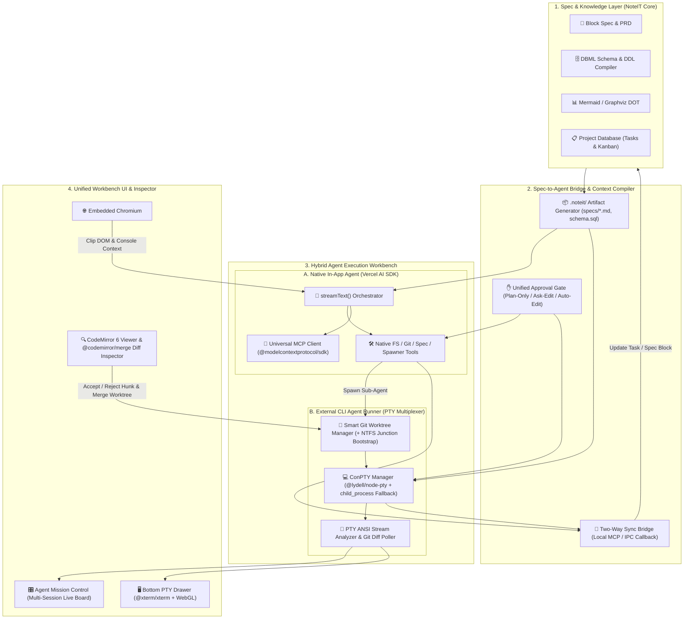

# NoteIT ADE (Agentic Development Environment) & AI Agent Workbench — Master Architecture Blueprint

> **Visi Produk**: Mengubah **NoteIT Workbench v2.0** dari aplikasi spesifikasi & catatan rekayasa menjadi **Personal SuperApp & Spec-Driven ADE (Agentic Development Environment)** — menggabungkan kekuatan perencanaan terstruktur (*Block Spec, DBML, Mermaid/DOT, Spatial Canvas, Project Database*) dengan orkestrasi agen otonom hibrida (**In-App Vercel AI SDK Agent** + **External CLI Agents di PTY & Git Worktree**).

---

## 1. Keputusan Arsitektur Kunci (Locked Design Decisions)

Seluruh desain di dokumen ini telah dikunci berdasarkan 10 keputusan arsitektural utama:

| # | Area Arsitektur | Keputusan yang Dikunci | Rasional & Keunggulan Teknis |
| :- | :--- | :--- | :--- |
| **1** | **Paradigma Eksekusi Agen** | **Hybrid Orchestrator** (In-App Agent + PTY CLI Agent Runner) | In-App Agent (Vercel AI SDK) menangani *Spec-to-Code* ringan, orkestrasi, dan review; CLI Agent eksternal (`claude`, `codex`, `gemini`, `aider`) menangani *heavy repo coding* di atas Git Worktree. |
| **2** | **Topologi UI & Layout** | **Unified Spec-First Workbench + Agent Mission Control** | Di layar Spec ada **Bottom Drawer** (PTY Terminal Multiplexer) & **Flexible Right Split Pane** (Page / Browser / Code & Diff / AI Chat), ditambah view utama **Agent Mission Control** di sidebar. |
| **3** | **Spec-to-Agent Handoff** | **Workspace Artifact Drop (`.noteit/`) + Two-Way Sync Bridge** | Menghindari masalah *multiline escaping* di PowerShell/ConPTY dengan menulis `.noteit/specs/<CODE>.md` & `schema.sql` di worktree, lalu memicu agen lewat perintah pendek + bridge dua arah untuk update status task. |
| **4** | **Stack Terminal PTY (Windows)** | **Prebuilt ConPTY (`@lydell/node-pty` / `node-pty`) + Graceful `child_process` Fallback + `@xterm/xterm`** | Mendukung TUI interaktif 60fps (WebGL) untuk Claude Code / Codex / PowerShell, namun tetap aman (tidak pernah *crash*) jika binary native gagal dimuat. |
| **5** | **In-App Agent Toolset & MCP** | **Full Coding + Orchestrator Toolset + Dynamic MCP Client (`@modelcontextprotocol/sdk`)** | In-App Agent memiliki akses Repo FS, Git/Terminal (dengan Approval Gate), Task Updater, Worktree Spawner, dan koneksi langsung ke MCP Server (`codebase-memory-mcp`, `playwright`, dll.). |
| **6** | **Isolasi Git Worktree** | **Smart Worktree Mode (Direct vs Isolated) + Auto-Bootstrap NTFS Junction** | Mendukung eksekusi langsung di repo utama (1 agen) atau cabang *worktree* terisolasi (multi-agen), dengan *auto-junction* `node_modules`/`.venv` (`fs.symlinkSync(..., 'junction')`, <5ms, 0 byte disk, tanpa Admin) & salin `.env*`. |
| **7** | **Engine Code & Diff Inspector** | **CodeMirror 6 + `@codemirror/merge`** | Jauh lebih ringan dari Monaco (~150KB vs ~8MB), bebas masalah Web Worker di CSP Electron offline, mendukung *Side-by-Side & Unified Diff*, *Accept/Reject per-hunk*, edit kode manual, dan navigasi WikiLink `[[src/file.ts#L120]]`. |
| **8** | **Telemetri & Deteksi Status Agen** | **Smart PTY Stream Analyzer + Live Git Diff Poller + Bridge Callback** | Mendeteksi otomatis saat CLI agent di PTY menunggu konfirmasi `[y/n]` (`Waiting for Approval ✋`) atau menjalankan test (`Running Tests`), serta memantau `+added / -removed` baris secara *real-time*. |
| **9** | **Model Data & Persistensi SQLite** | **Notebook Default `repoPath` + Section Override + Full SQLite Session Persistence** | Menyimpan `repo_path` di `notebooks` (plus *override* opsional di `sections` untuk proyek multi-repo frontend/backend) serta tabel `agent_sessions`, `agent_messages`, dan `mcp_servers` di `noteit-v2.db` untuk *Session Resume*. |
| **10** | **Preset CLI Agents & Otonomi** | **Auto-Detect Installed CLIs + Smart Flag Mapping** | Mendeteksi binary CLI di `PATH` Windows secara otomatis dan memetakan mode `plan-only` / `ask-edit` / `auto-edit` NoteIT ke *flag* CLI masing-masing (plus dukungan Custom CLI template). |

---

## 2. Diagram Arsitektur End-to-End (Hybrid ADE Orchestrator)



---

## 3. Daftar Paket & Tech Stack (Dependency Matrix)

Berikut adalah daftar paket yang sudah ada dan paket baru yang diperlukan untuk mengimplementasikan seluruh fitur ADE tanpa merusak aturan *offline-first* dan kecepatan *build* Vite + Electron 35:

### 3.1 Paket Baru yang Akan Ditambahkan (`package.json`)

| Kategori | Nama Paket NPM | Proses Target | Fungsi Spesifik di NoteIT ADE |
| :--- | :--- | :--- | :--- |
| **PTY Terminal (Main)** | `@lydell/node-pty` *(atau `node-pty`)* | `main` (Externalized di Vite) | Prebuilt ConPTY untuk Windows/macOS/Linux. Dibalut dengan *try-catch dynamic import* + fallback ke `node:child_process` agar 100% bebas crash. |
| **Terminal UI (Renderer)** | `@xterm/xterm`<br>`@xterm/addon-fit`<br>`@xterm/addon-webgl`<br>`@xterm/addon-web-links` | `renderer` | Rendering emulator terminal 60fps dengan akselerasi WebGL, auto-fit ukuran drawer/pane, dan klik tautan file/URL langsung dari output terminal. |
| **Code & Diff Inspector** | `@codemirror/state`<br>`@codemirror/view`<br>`@codemirror/merge`<br>`@codemirror/language`<br>`@codemirror/lang-javascript`<br>`@codemirror/lang-python`<br>`@codemirror/lang-sql`<br>`@codemirror/lang-json`<br>`@codemirror/lang-markdown`<br>`@codemirror/lang-html`<br>`@codemirror/lang-css` | `renderer` | Code Viewer ringan, editor manual cepat, navigasi baris `[[file#L120]]`, serta **Side-by-Side & Unified Git Diff Inspector** dengan tombol *Accept/Reject Hunk*. |
| **Universal MCP Client** | `@modelcontextprotocol/sdk` | `main` | Menghubungkan In-App Agent ke MCP Server eksternal melalui transport `StdioClientTransport` maupun `SSEClientTransport` / `StreamableHTTPClientTransport`. |

> [!TIP]
> **Mengapa Tidak Menggunakan Paket Git Pihak Ketiga?**
> Untuk operasi Git (`status`, `diff`, `worktree add/list/remove`, `branch`, `apply`, `merge`), kita menggunakan modul `execFile` bawaan `node:child_process` yang memanggil binary `git` sistem secara langsung dengan argumen array (bebas *shell injection*). Ini menjaga ukuran bundle tetap nol dan kompatibel 100% dengan konfigurasi Git lokal pengguna.

---

## 4. Topologi UI & Pengalaman Pengguna (UX Flow)

### 4.1 Empat Area Kerja Terpadu
1. **Spec Workbench (Layar Utama)**:
   - Di [`SpecHeader.tsx`](file:///D:/Project/NoteIT/src/renderer/src/components/layout/SpecHeader.tsx), muncul badge **Repo Binding** (misal: `📁 NoteIT · main`) dan tombol **`⚡ Dispatch to Agent`**.
   - **Right Split Pane Selector**: Pengguna dapat memilih isi *pane* kanan secara fleksibel:
     - `📄 Split Spec Page` (Bandingkan dua dokumen spesifikasi)
     - `🌐 In-App Browser` (Riset referensi web & *Clip to Spec*)
     - `🔍 Repo & Diff Inspector` (File tree proyek + CodeMirror 6 Code/Diff Viewer)
     - `🤖 In-App Agent Drawer` (Chat & *tool execution* langsung di samping halaman aktif)
2. **Dockable Bottom Terminal Drawer (`Ctrl+\``)**:
   - Panel bawah yang bisa dibuka/tutup atau di-*resize* dari layar mana pun.
   - Mendukung **Multi-Tab PTY Sessions** (PowerShell, Bash, Claude Code, Codex, Gemini CLI, Aider), lengkap dengan indikator *working directory* (otomatis mengarah ke `repoPath` Notebook/Section atau folder Worktree aktif).
   - Dilengkapi tombol **`Capture Last Error to Spec`** yang mengekstrak *stack trace* terakhir dari buffer terminal menjadi blok *Callout* atau *Issue* di halaman aktif.
3. **Agent Mission Control (`activeMainView === 'agent-board'`, Pintasan `Ctrl+Shift+A`)**:
   - **Multi-Agent Session Board (Grid / Kanban View)** untuk mengawasi seluruh agen yang berjalan paralel lintas *worktree* dan lintas proyek.
   - Setiap kartu sesi menampilkan:
     - Nama tugas & tautan ke halaman Spec (`ARC-04 · Sistem Autentikasi`) atau item Task (`TSK-02`).
     - Tipe eksekutor (`Claude Code CLI`, `Codex CLI`, `Gemini CLI`, atau `NoteIT In-App SDK`).
     - Cabang & Path Worktree (`feat/arc-04` · `../NoteIT-worktrees/arc-04`).
     - Status *real-time* (`Idle`, `Thinking`, `Waiting for Approval ✋`, `Running Tests 🧪`, `Completed ✅`, `Failed ❌`).
     - Statistik perubahan *live* (`3 files changed · +142 -18`).
     - Cuplikan log terminal / aktivitas terakhir (3 baris *live tail*).
     - Tombol aksi cepat: **Open Terminal**, **Inspect Diff**, **Approve `[y]`**, **Merge to Main**, dan **Discard Worktree**.
4. **Code-to-Spec WikiLink Navigation**:
   - Di dalam blok teks NoteIT, pengguna atau agen dapat menulis `[[src/main/index.ts#L120]]` atau `[[src/main/services/ai.service.ts#L40-L75]]`.
   - Saat diklik, NoteIT otomatis membuka **Right Split Pane (`Repo & Diff Inspector`)**, memuat file tersebut dari `repoPath`, dan men-*scroll* serta menyorot (*highlight*) baris `120`.

---

## 5. Spesifikasi Teknis Per Pilar

### Pilar 1: Spec-to-Agent Bridge (`.noteit/` Context Compiler & Two-Way Sync)

#### A. Struktur Bundle `.noteit/` di Repo / Worktree
Saat pengguna menekan **`⚡ Dispatch to Agent`** pada halaman `ARC-04`, `SpecCompilerService` (`src/main/services/spec-compiler.service.ts`) menyusun artefak berikut di dalam direktori kerja agen (`<worktreeOrRepoPath>/.noteit/`):

```text
<repo-or-worktree>/
└── .noteit/
    ├── active-task.md          # Kompilasi lengkap halaman Spec aktif + instruksi tugas
    ├── schema.sql              # Hasil kompilasi otomatis seluruh blok DBML di halaman/notebook ke DDL SQL
    ├── architecture.mmd        # Kumpulan diagram Mermaid / DOT dari halaman terkait
    ├── task-contract.json      # Metadata JSON (pageId, pageCode, taskIds, approvalMode)
    └── status-update.json      # File watch target: jika CLI agent menulis ke file ini, NoteIT otomatis meng-update status task/checklist di SQLite!
```

> [!IMPORTANT]
> **Zero Git Pollution**: `SpecCompilerService` otomatis menambahkan `.noteit/` ke dalam `<repo>/.git/info/exclude` (lokal Git exclude milik repo tersebut), sehingga folder `.noteit/` **tidak pernah mengotori `git status`** dan tidak perlu mengubah file `.gitignore` proyek milik tim!

#### B. Mekanisme Handoff ke CLI Agent vs In-App Agent
1. **Ke CLI Agent di PTY (`claude`, `codex`, `gemini`, `aider`)**:
   - Alih-alih mengirimkan ratusan baris Markdown lewat `stdin`, NoteIT cukup mengirimkan satu baris perintah bersih ke PTY:
     ```text
     Bacalah spesifikasi lengkap di .noteit/active-task.md dan skema database di .noteit/schema.sql, lalu implementasikan sesuai kontrak tersebut. Saat sub-tugas selesai, perbarui .noteit/status-update.json.
     ```
2. **Sinkronisasi Dua Arah (Two-Way Sync)**:
   - **Jalur 1 (File Watcher `.noteit/status-update.json`)**: `fs.watch` di Main Process memantau `.noteit/status-update.json`. Ketika CLI Agent menuliskan progres (misal mencentang checklist atau mengubah status `TSK-01` menjadi `review` / `done` atau menambahkan catatan implementasi), NoteIT langsung memperbarui SQLite `pages` dan me-refresh UI secara *real-time*.
   - **Jalur 2 (In-App Agent Native Tool)**: In-App Agent memanggil tool `update_spec_task_status` secara langsung.

---

### Pilar 2: Smart Git Worktree Manager & Multi-Agent Session Board

#### A. Algoritma `WorktreeService` (`src/main/services/worktree.service.ts`)
Ketika pengguna memilih **Isolated Worktree Mode** saat men-dispatch agen untuk halaman `ARC-04`:

1. **Pembuatan Worktree & Cabang**:
   - Menentukan folder induk *sibling*: `<parentDir>/<repoName>-worktrees/wt-<slug>`.
   - Menjalankan:
     ```bash
     git worktree add -b feat/arc-04 "<worktreePath>" HEAD
     ```
2. **Auto-Bootstrap Environment (Windows NTFS Junction & Dotenv Copy)**:
   - Memindai folder dependensi di repo utama: `node_modules`, `.venv`, `venv`, `.pnpm-store`.
   - Jika ada di repo utama dan belum ada di worktree, jalankan:
     ```ts
     fs.symlinkSync(
       path.join(mainRepoPath, 'node_modules'),
       path.join(worktreePath, 'node_modules'),
       'junction' // Tidak butuh Admin privilege di Windows, instan <5ms!
     )
     ```
   - Menyalin file environment lokal (`.env`, `.env.local`, `.env.development`) dari repo utama ke worktree.
3. **Merge & Cleanup Lifecycle**:
   - **Inspect Diff**: Membuka perbandingan antara `HEAD` worktree (termasuk *uncommitted working tree*) terhadap cabang utama.
   - **Merge Worktree to Main**:
     1. Jika masih ada perubahan *uncommitted* di worktree, otomatis lakukan `git add -A && git commit -m "feat(ARC-04): <summary>"`.
     2. Di repo utama, jalankan `git merge --no-ff feat/arc-04`.
     3. Lepas junction `node_modules` terlebih dahulu (`fs.unlinkSync` pada junction point agar `git worktree remove` tidak menghapus isi `node_modules` asli!), lalu jalankan `git worktree remove "<worktreePath>"`.

> [!CAUTION]
> **Aturan Keselamatan NTFS Junction Saat Menghapus Worktree**:
> Sebelum memanggil `git worktree remove --force` atau `fs.rmSync` pada folder worktree, `WorktreeService` **WAJIB** melepas (*unlink*) semua *directory junction* (`node_modules`, `.venv`) terlebih dahulu menggunakan `fs.unlinkSync(junctionPath)`. Ini memastikan isi `node_modules` di repo utama tidak pernah ikut terhapus.

#### B. Smart PTY Stream Analyzer (`src/main/services/terminal.service.ts`)
Setiap sesi PTY melewati *ring buffer* (4KB terakhir setelah di-strip karakter ANSI escape):
- **Deteksi `waiting_approval`**: Jika stream berhenti mengeluarkan output selama >400ms dan baris terakhir cocok dengan regex `/(\[y\/n\]|\[Y\/n\]|\(y\/n\)|Allow\s+.*\?|Do you want to proceed|Approve\?)/i`, status sesi otomatis berubah menjadi `'waiting_approval'` dan menampilkan tombol **Quick Approve (`y + Enter`) / Reject (`n + Enter`)** langsung di kartu Agent Mission Control.
- **Deteksi `running_tests`**: Jika baris output memuat eksekusi test runner (`vitest`, `jest`, `pytest`, `cargo test`, `go test`, `npm test`), status berubah menjadi `'running_tests'`.

#### C. Auto-Detect CLI Agent Presets & Flag Mapping
NoteIT memeriksa keberadaan binary di `PATH` menggunakan `where.exe <bin>` (Windows) / `which <bin>` (POSIX) dan memetakan mode persetujuan NoteIT:

| Preset CLI | Binary | Mode `plan-only` | Mode `ask-edit` (Default) | Mode `auto-edit` |
| :--- | :--- | :--- | :--- | :--- |
| **Claude Code** | `claude` | `claude --permission-mode plan` | `claude` | `claude --dangerously-skip-permissions` |
| **OpenAI Codex** | `codex` | `codex --ask-for-approval untrusted` | `codex` | `codex --full-auto` |
| **Gemini CLI** | `gemini` | `gemini` | `gemini` | `gemini --yolo` |
| **Aider** | `aider` | `aider --architect` | `aider` | `aider --yes-always` |
| **Custom Shell** | `pwsh` / `cmd` | Membuka shell interaktif di CWD | Membuka shell interaktif di CWD | Membuka shell interaktif di CWD |

---

### Pilar 3: Local Repo Explorer, CodeMirror 6 Viewer & Git Diff Inspector

#### A. `RepoService` (`src/main/services/repo.service.ts`)
1. **Lazy Directory Listing (`repo:readDir`)**:
   - Membaca isi direktori satu level per permintaan, mengurutkan folder di atas file, dan menyembunyikan `.git`, `node_modules`, `dist`, `out`, `.noteit` secara otomatis.
2. **Git Status & Diff Provider (`repo:getGitStatus`, `repo:getFileDiff`)**:
   - Menjalankan `git status --porcelain -uall` untuk memberi badge warna pada pohon file (`M` Modified = Amber, `A`/`?` Added/Untracked = Teal, `D` Deleted = Red).
   - Mengambil konten asli (`git show HEAD:<relativePath>`) dan konten kerja saat ini (`fs.readFileSync`) untuk dirender berdampingan di `@codemirror/merge`.
3. **Interactive Hunk / File Approval (`repo:stageOrRevertFile`, `repo:applyPatch`)**:
   - Pengguna dapat menerima/menolak perubahan per-blok (*revert hunk* langsung di editor `@codemirror/merge` lalu simpan) atau me-*discard* seluruh perubahan file (`git checkout -- <file>`).

---

### Pilar 4: Persenjataan In-App Agent & Universal MCP Client

#### A. Perluasan Tools di [`ai.service.ts`](file:///D:/Project/NoteIT/src/main/services/ai.service.ts)
Selain 4 tools spesifikasi yang sudah ada, In-App Agent dibekali 7 tools baru ketika Notebook/Section memiliki `repoPath`:

| Nama Tool | Kategori | Butuh Approval Gate (`ask-edit`)? | Deskripsi Fungsi |
| :--- | :--- | :---: | :--- |
| `list_repo_files` | Repo FS | Tidak (Read-Only) | Menampilkan daftar file di dalam `repoPath` / worktree aktif. |
| `read_repo_file` | Repo FS | Tidak (Read-Only) | Membaca isi file sumber berdasarkan path relatif dan rentang baris (`startLine`, `endLine`). |
| `search_repo_code` | Repo FS | Tidak (Read-Only) | Mencari pola teks/simbol di seluruh kode sumber repositori. |
| `get_git_diff_summary` | Git | Tidak (Read-Only) | Membaca daftar file yang berubah beserta ringkasan `git diff` di repo/worktree. |
| `propose_repo_file_edit` | Repo Mutator | **Ya** (di `ask-edit`) | Mengajukan pembuatan file baru atau penggantian blok kode (`target` -> `replacement`) dengan pratinjau Diff di UI chat sebelum ditulis ke disk. |
| `run_repo_command` | Terminal | **Ya** (di `ask-edit`) | Menjalankan perintah shell/test di dalam `repoPath` / worktree dan mengembalikan `stdout`/`stderr`. |
| `update_spec_task_status` | Spec Bridge | Tidak | Mengubah status item `ProjectTaskItem` (`backlog` / `in_progress` / `review` / `done`) atau checklist di halaman Spec. |
| `spawn_cli_agent_session` | Orchestrator | **Ya** (di `ask-edit`) | Memungkinkan In-App Agent mendelegasikan sub-tugas berat ke sesi CLI Agent baru di Git Worktree terisolasi. |

#### B. Universal MCP Client (`src/main/services/mcp.service.ts`)
- Mengelola koneksi ke MCP Server yang dikonfigurasi pengguna di **Settings -> MCP Servers** (contoh: `codebase-memory-mcp`, `playwright`, `sqlite`, `github`).
- Saat `executeAIChatStream` dipanggil, `mcpService.getActiveToolsForAiSdk()` mengonversi seluruh skema JSON Schema dari MCP Server yang terhubung menjadi objek `tool()` Vercel AI SDK secara dinamis.

---

## 6. Skema Database SQLite (`noteit-v2.db` Migrations)

Migrasi dilakukan secara **aditif & idempoten** di [`src/main/db/client.ts`](file:///D:/Project/NoteIT/src/main/db/client.ts) agar 100% kompatibel dengan database pengguna yang sudah ada:

```sql
-- 1. Kolom tambahan pada tabel notebooks & sections (via ALTER TABLE jika belum ada)
ALTER TABLE notebooks ADD COLUMN repo_path TEXT DEFAULT NULL;
ALTER TABLE notebooks ADD COLUMN default_branch TEXT DEFAULT 'main';
ALTER TABLE sections ADD COLUMN repo_path_override TEXT DEFAULT NULL;

-- 2. Tabel Sesi Agen & Worktree (Agent Mission Control Persistence)
CREATE TABLE IF NOT EXISTS agent_sessions (
  id TEXT PRIMARY KEY,
  notebook_id TEXT NOT NULL REFERENCES notebooks(id) ON DELETE CASCADE,
  section_id TEXT REFERENCES sections(id) ON DELETE SET NULL,
  page_id TEXT REFERENCES pages(id) ON DELETE SET NULL,
  task_code TEXT DEFAULT NULL,
  title TEXT NOT NULL,
  agent_preset TEXT NOT NULL,            -- 'in-app' | 'claude' | 'codex' | 'gemini' | 'aider' | 'custom'
  command TEXT NOT NULL,
  approval_mode TEXT NOT NULL,           -- 'plan-only' | 'ask-edit' | 'auto-edit'
  isolation_mode TEXT NOT NULL,          -- 'direct' | 'worktree'
  repo_path TEXT NOT NULL,
  worktree_path TEXT DEFAULT NULL,
  branch_name TEXT DEFAULT NULL,
  status TEXT NOT NULL DEFAULT 'idle',   -- 'idle' | 'thinking' | 'waiting_approval' | 'running_tests' | 'completed' | 'failed' | 'merged'
  files_changed INTEGER NOT NULL DEFAULT 0,
  lines_added INTEGER NOT NULL DEFAULT 0,
  lines_removed INTEGER NOT NULL DEFAULT 0,
  last_output_tail TEXT NOT NULL DEFAULT '',
  created_at INTEGER NOT NULL,
  updated_at INTEGER NOT NULL
);

-- 3. Tabel Riwayat Pesan Chat & Proposal per Sesi/Halaman
CREATE TABLE IF NOT EXISTS agent_messages (
  id TEXT PRIMARY KEY,
  session_id TEXT NOT NULL REFERENCES agent_sessions(id) ON DELETE CASCADE,
  role TEXT NOT NULL,                    -- 'user' | 'assistant' | 'system' | 'tool'
  content TEXT NOT NULL,
  tool_calls_json TEXT DEFAULT '[]',
  proposal_json TEXT DEFAULT NULL,
  created_at INTEGER NOT NULL
);

-- 4. Tabel Konfigurasi MCP Server
CREATE TABLE IF NOT EXISTS mcp_servers (
  id TEXT PRIMARY KEY,
  name TEXT NOT NULL,
  transport TEXT NOT NULL,               -- 'stdio' | 'sse'
  command_or_url TEXT NOT NULL,
  args_json TEXT NOT NULL DEFAULT '[]',
  env_json TEXT NOT NULL DEFAULT '{}',
  enabled INTEGER NOT NULL DEFAULT 1,
  created_at INTEGER NOT NULL
);
```

---

## 7. Kontrak IPC Baru (`src/shared/ipc-channels.ts`)

| Channel IPC | Arah | Payload Request | Payload Response / Event |
| :--- | :---: | :--- | :--- |
| `workspace:updateNotebookRepo` | `R -> M` | `{ notebookId, repoPath, defaultBranch }` | `Notebook` |
| `workspace:updateSectionRepo` | `R -> M` | `{ sectionId, repoPathOverride }` | `Section` |
| `repo:pickFolder` | `R -> M` | `{ defaultPath?: string }` | `{ canceled: boolean; path?: string; isGitRepo: boolean; branch?: string }` |
| `repo:readDir` | `R -> M` | `{ repoPath: string; relPath?: string }` | `RepoEntry[]` (nama, tipe, status git) |
| `repo:readFile` | `R -> M` | `{ repoPath: string; relPath: string }` | `{ content: string; headContent: string | null; language: string }` |
| `repo:writeFile` | `R -> M` | `{ repoPath: string; relPath: string; content: string }` | `{ ok: boolean }` |
| `repo:getGitStatus` | `R -> M` | `{ repoPath: string }` | `RepoGitStatusSummary` (branch, changedFiles, +lines, -lines) |
| `repo:discardFileChanges` | `R -> M` | `{ repoPath: string; relPath: string }` | `{ ok: boolean }` |
| `terminal:detectClis` | `R -> M` | `{}` | `DetectedCliPreset[]` (`claude`, `codex`, `gemini`, `aider`, `pwsh`, `git`) |
| `terminal:createSession` | `R -> M` | `{ cwd: string; command?: string; args?: string[]; sessionId?: string }` | `{ ptyId: string; mode: 'conpty' \| 'subprocess' }` |
| `terminal:write` | `R -> M` | `{ ptyId: string; data: string }` | `void` |
| `terminal:resize` | `R -> M` | `{ ptyId: string; cols: number; rows: number }` | `void` |
| `terminal:kill` | `R -> M` | `{ ptyId: string }` | `void` |
| `terminal:event` | `M -> R` | *(Stream Event)* | `{ ptyId, type: 'data' \| 'exit' \| 'state-change', data?, exitCode?, detectedState? }` |
| `agent:dispatchSpec` | `R -> M` | `DispatchSpecInput` (pageId, preset, isolationMode, approvalMode, customPrompt) | `AgentSessionRecord` |
| `agent:listSessions` | `R -> M` | `{ notebookId?: string }` | `AgentSessionRecord[]` |
| `agent:mergeWorktree` | `R -> M` | `{ sessionId: string; commitMessage?: string }` | `{ ok: boolean; error?: string }` |
| `agent:discardWorktree` | `R -> M` | `{ sessionId: string }` | `{ ok: boolean }` |
| `mcp:listServers` | `R -> M` | `{}` | `McpServerRecord[]` |
| `mcp:upsertServer` | `R -> M` | `McpServerInput` | `McpServerRecord` |
| `mcp:testConnection` | `R -> M` | `{ serverId: string }` | `{ ok: boolean; tools: string[]; error?: string }` |

---

## 8. Peta Jalan Implementasi Modular (Execution Phases)

Ketika siap dieksekusi ke kode, pembangunan dibagi menjadi 4 paket kerja berurutan yang bersih:

### Paket Kerja A: Fondasi Data, Repo Binding & Spec Compiler (`.noteit/`)
1. Perbarui `src/shared/types/domain.ts` dan `src/shared/ipc-channels.ts` dengan tipe `AgentSessionRecord`, `RepoEntry`, `McpServerRecord`, serta properti `repoPath` pada `Notebook` & `Section`.
2. Tambahkan migrasi tabel `agent_sessions`, `agent_messages`, `mcp_servers`, serta kolom `repo_path` di `src/main/db/client.ts`.
3. Bangun `src/main/services/repo.service.ts` (pemilihan folder repo, pembacaan pohon direktori dengan filter `.gitignore`, pembacaan `git status` & `git show HEAD:<file>`).
4. Bangun `src/main/services/spec-compiler.service.ts` (kompilasi halaman aktif + DDL SQL dari DBML + Mermaid ke `.noteit/active-task.md` & `.noteit/schema.sql`, otomatis mendaftarkan `.noteit/` ke `.git/info/exclude`, serta `fs.watch` pada `.noteit/status-update.json`).

### Paket Kerja B: Embedded PTY Terminal Multiplexer & Smart Stream Analyzer
1. Instal `@lydell/node-pty` (atau `node-pty`) dan `@xterm/xterm` + addons.
2. Bangun `src/main/services/terminal.service.ts` dengan arsitektur *Dual-Driver* (ConPTY utama + graceful fallback ke `child_process.spawn`), pendeteksi binary CLI di `PATH`, dan *ANSI-stripped stream analyzer* untuk mendeteksi status `waiting_approval` / `running_tests`.
3. Bangun komponen `src/renderer/src/components/terminal/BottomTerminalDrawer.tsx` (multi-tab terminal, selector profil shell/CLI agent, tombol *Capture Error to Spec*, dan pintasan `Ctrl+\``).

### Paket Kerja C: Smart Git Worktree Manager & Agent Mission Control Board
1. Bangun `src/main/services/worktree.service.ts` (`git worktree add`, auto-bootstrap NTFS junction `node_modules`/`.venv`, penyalinan `.env*`, poller `git diff --shortstat`, *safe junction unlink* sebelum `git worktree remove`, dan *1-Click Merge to Main*).
2. Bangun `src/renderer/src/components/agents/AgentMissionControlView.tsx` (Grid/Kanban *live session board*, indikator status *real-time*, tombol *Quick Approve `[y]`*, *Open in Terminal*, *Inspect Diff*, dan *Merge/Discard Worktree*).
3. Tambahkan modal/popover **`⚡ Dispatch Spec to Agent`** di `SpecHeader.tsx` untuk memilih eksekutor (In-App SDK vs Claude/Codex/Gemini/Aider CLI), mode isolasi (Direct Repo vs Isolated Worktree), dan mode otonomi (`Plan` / `Ask` / `Auto`).

### Paket Kerja D: CodeMirror 6 Diff Inspector, WikiLink Code Navigation & Universal MCP
1. Instal paket `@codemirror/view`, `@codemirror/state`, `@codemirror/merge`, dan paket bahasa terkait.
2. Bangun `src/renderer/src/components/repo/RepoDiffInspectorPane.tsx` (pohon file di kiri/atas, CodeMirror 6 viewer & *Side-by-Side / Inline Diff* di kanan, tombol *Accept/Reject File & Hunk*, serta dukungan lompat baris dari WikiLink `[[path/to/file.ts#L120]]`).
3. Perluas `src/main/services/ai.service.ts` dengan 7 tools repo/git/terminal/orchestrator (dengan Approval Gate untuk operasi tulis/eksekusi) dan hubungkan dengan `src/main/services/mcp.service.ts` (`@modelcontextprotocol/sdk`).
