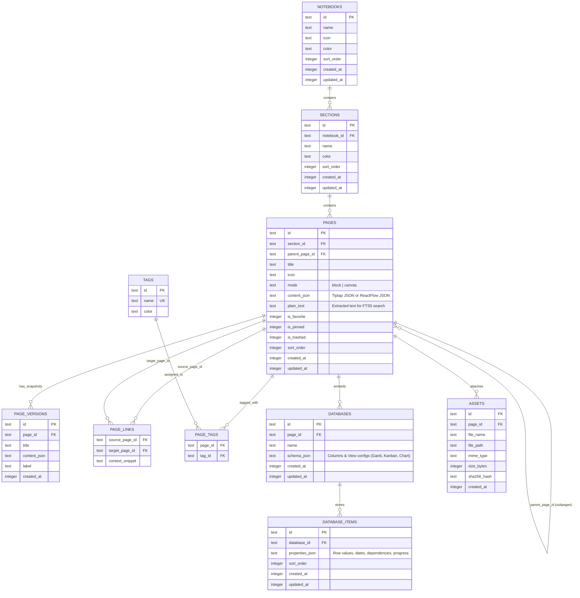

# Product Requirements Document (PRD): NoteIT v2.0

> [!IMPORTANT]
> **NoteIT v2.0** adalah perombakan total (*clean-slate rebuild*) menjadi aplikasi desktop **Offline-First** super-powerful yang menggabungkan struktur **Notion**, organisasi & fleksibilitas **Microsoft OneNote**, serta kemampuan **Native Diagramming (DBML, Mermaid, Graphviz)** dan **Interactive Charting (Gantt, Kanban, Data Charts)** dalam satu workspace lokal berbasis **Electron + SQLite**.

---

## 1. Visi & Tujuan Produk

### 1.1 Masalah yang Diselesaikan
* **Fragmentasi Tools Developer & Knowledge Worker**: Pengguna harus berpindah-pindah antara Notion (catatan & task), OneNote/Miro (kanvas bebas), dbdiagram.io (DBML), PlantUML/Mermaid live editor (diagram arsitektur), dan Excel/Chart tools (visualisasi & Gantt chart).
* **Ketergantungan Cloud & Latensi**: Banyak aplikasi modern lambat saat offline atau membutuhkan koneksi internet untuk me-render diagram dan mencari catatan.

### 1.2 Solusi Utama NoteIT v2.0
1. **100% Offline-First & Local Speed**: Semua catatan, diagram, database tabel lokal, dan indeks pencarian tersimpan di **SQLite (`better-sqlite3` + `FTS5`)** dengan waktu respon `< 15ms`.
2. **Structured Organization + Dual-Mode Page**: Hirarki jelas ala OneNote (**Notebook > Section > Page > Subpage**) yang dikombinasikan dengan **Tags**, **Favorites**, dan **Bi-directional Wiki-Links (`[[Page]]`)**. Setiap Page dapat dibuat dalam mode **Block Document (ala Notion)** atau **Spatial Freeform Canvas (ala OneNote/Heptabase)**.
3. **First-Class Engineering Diagrams**: Blok kode ke diagram interaktif secara *offline* untuk **DBML** (tabel ER bisa di-drag, auto-layout, highlight relasi Foreign Key), **Mermaid.js**, dan **Graphviz (DOT via WASM)**.
4. **Built-in Project & Data Charting**: Mendukung **Interactive Gantt Chart** (dengan *task dependency* & *milestone*), **Kanban Board**, **Calendar**, serta **Data Charts** (Bar, Line, Area, Pie) langsung dari tabel lokal di dalam catatan.

---

## 2. Spesifikasi Fitur Utama (Core Functional Requirements)

### 2.1 Manajemen Organisasi & Navigasi
* **Hirarki 3-Level + Subpage**:
  * `Notebook` (Workspace tingkat atas, bisa diberi ikon & warna tema)
  * `Section` (Kategori di dalam Notebook)
  * `Page` & `Subpage` (Catatan di dalam Section, mendukung *nesting* hingga subpage untuk kerapian struktur)
* **Cross-Cutting Organization**:
  * **Global Tags**: Multi-tag per halaman dengan warna kustom dan filter cepat.
  * **Bi-directional Linking (`[[mention]]`)**: Ketik `[[` di dalam editor atau kartu kanvas untuk menautkan ke halaman lain; setiap halaman menampilkan panel **Backlinks** (daftar halaman yang mereferensikan halaman tersebut).
  * **Favorites / Pinned Pages**: Akses cepat di bagian atas sidebar.
* **Desktop Power-User Workspace**:
  * **Multi-Tab & Split Pane**: Buka beberapa halaman sekaligus dalam tab, atau *split* layar (misal: tulis spesifikasi di panel kiri sambil melihat diagram DBML atau Gantt Chart di panel kanan).
  * **Command Palette (`Ctrl+K` / `Cmd+K`)**: Pencarian *full-text* instan (SQLite FTS5) lintas judul halaman, isi blok, kode DBML/Mermaid, dan tag, sekaligus eksekusi cepat (*Quick Actions*).
  * **Local Version History (Snapshots)**: Penyimpanan *snapshot* otomatis & manual di SQLite sehingga pengguna bisa melihat *diff* dan mengembalikan versi catatan sebelumnya kapan saja secara offline.

### 2.2 Dual-Mode Page Engine

#### Mode A: Block Document Mode (Referensi: Notion)
* **Slash Command (`/`)**: Ketik `/` untuk menyisipkan blok:
  * **Teks & Tipografi**: Heading 1–3, Paragraph, Callout Box, Quote, Toggle List, Bullet/Numbered List, Checklist (`[ ]`).
  * **Layout Multi-Kolom**: Susun blok berdampingan (2–4 kolom).
  * **Code Block**: Syntax highlighting dengan **CodeMirror 6 / Shiki** + tombol *Copy*.
  * **Diagram Block**: Blok khusus **DBML**, **Mermaid**, dan **Graphviz DOT** dengan tampilan *Split (Code + Preview)*, *Preview Only*, atau *Code Only*.
  * **Local Database / Structured Table Block**: Tabel data ber-skema lokal (kolom bertipe Text, Number, Select, Status, Date Range, Dependency, Checkbox) yang dapat di-render menjadi view **Table**, **Gantt Chart**, **Kanban**, **Calendar**, atau **Data Chart**.
  * **Media & File Attachment**: Gambar (dengan *resize* & *caption*), file PDF/dokumen lokal yang disimpan di folder `assets/` lokal.

#### Mode B: Spatial Freeform Canvas Mode (Referensi: OneNote + Spatial Canvas)
* **Infinite 2D Spatial Canvas** berbasis `@xyflow/react`:
  * **Rich Note Cards**: Klik ganda di koordinat mana pun untuk membuat kartu catatan (mendukung *rich text* & *slash command* di dalam kartu).
  * **Embedded Diagram & Chart Nodes**: Taruh diagram DBML, diagram Mermaid, tabel, atau grafik langsung sebagai node di atas kanvas.
  * **Visual Connectors (Edges)**: Tarik garis panah/konektor antar kartu catatan, tabel DBML, atau sticky notes lengkap dengan label garis.
  * **Sticky Notes, Shapes & Grouping**: Kotak grup visual (*Frame/Section Box*) untuk mengelompokkan kartu di atas kanvas.

### 2.3 Fitur Diagramming (100% Offline-Native)

| Engine | Use Case Utama | Fitur Interaktif |
| :--- | :--- | :--- |
| **DBML Engine** (`@dbml/core` + `@xyflow/react` + `elkjs`) | Database Schema / ERD | Parse sintaks DBML secara *real-time* menjadi node tabel interaktif. Tabel bisa di-drag posisinya (koordinat tersimpan di SQLite), klik kolom Foreign Key menyorot garis relasi, *auto-layout* 1 klik, serta *export* ke SQL DDL (PostgreSQL, MySQL, SQLite) atau SVG/PNG. |
| **Mermaid.js** (`mermaid`) | Flowchart, Sequence, Class, State, ER, Mindmap | Live preview dengan kontrol *Zoom & Pan* (bukan gambar statis kaku), pemilihan tema otomatis mengikuti Dark/Light mode aplikasi. |
| **Graphviz WASM** (`@hpcc-js/wasm`) | Arsitektur sistem kompleks & Directed Graphs (DOT) | Eksekusi *layout engine* `dot`, `neato`, `fdp` menggunakan WebAssembly secara lokal tanpa perlu menginstal Java atau Graphviz di OS pengguna. |

### 2.4 Fitur Charting & Project Management

* **Interactive Gantt Chart**:
  * Terhubung ke blok *Local Database/Table* atau berdiri sendiri sebagai blok Gantt.
  * Mendukung: **Task & Subtask**, **Start Date & End Date**, **Progress Bar (`0-100%`)**, **Dependency Arrows (Finish-to-Start)**, **Milestone Diamond**, serta **Drag-to-Move / Drag-to-Resize** durasi task langsung di timeline (skala Hari, Minggu, Bulan, Kuartal).
* **Data Visualization Charts**:
  * Grafik **Bar, Line, Area, Pie/Donut, Radar, dan Scatter** (berbasis **Recharts** / **Apache ECharts**).
  * Sumber data langsung dari tabel inline di dalam catatan atau *Local Database Block* (pilih kolom X-axis, Y-axis, dan tipe agregasi).

---

## 3. Tech Stack & Pemilihan Library

```mermaid
flowchart TB
    subgraph Electron["Electron Desktop Shell"]
        subgraph Renderer["Renderer Process (React 19 + TypeScript)"]
            UI["Tailwind CSS + shadcn/ui + Lucide"]
            Layout["Multi-Tab & Split Pane (allotment / dockview)"]
            State["Zustand + TanStack Query"]
            BlockEd["Block Editor (Tiptap / BlockNote)"]
            CanvasEd["Spatial Canvas & DBML UI (@xyflow/react)"]
            CodeEd["Code & DSL Editor (CodeMirror 6)"]
            Diagrams["Offline Renderers (@dbml/core, Mermaid, @hpcc-js/wasm)"]
            Charts["Gantt & Data Charts (Apache ECharts / Custom Timeline)"]
        end

        subgraph Preload["Preload Script (Context Bridge)"]
            IPC["Typed IPC API (window.noteitAPI)"]
        end

        subgraph Main["Main Process (Node.js)"]
            Services["Domain Services (Notebook, Page, Search, Export, Asset)"]
            ORM["Drizzle ORM + Migrator"]
            SQLite["better-sqlite3 (WAL Mode + FTS5)"]
            FS["Local File System (Workspace & Assets Folder)"]
        end
    end

    Renderer <-->|"Strict Typed IPC"| Preload
    Preload <-->|"ipcRenderer.invoke / ipcMain.handle"| Main
    Main --> ORM
    ORM --> SQLite
    Main --> FS
```



### Rincian Stack
* **Build & Desktop Runtime**: `electron-vite` (menggabungkan kecepatan Vite untuk Main, Preload, dan Renderer process) + `electron-builder` (packaging `.exe` / `.msi` untuk Windows, `.dmg` untuk macOS, `.AppImage` untuk Linux).
* **Bahasa**: **TypeScript** (`strict: true`) di seluruh layer (`main`, `preload`, `renderer`, dan `shared`).
* **Database Lokal**: **`better-sqlite3`** (sinkron, sangat cepat di Node.js Main Process, diaktifkan dengan `PRAGMA journal_mode = WAL;`) + **Drizzle ORM** untuk *type-safe query* dan *schema migration* otomatis saat aplikasi dibuka.
* **Search Engine Lokal**: **SQLite FTS5** (*Full-Text Search* bawaan SQLite dengan *tokenizer* `unicode61` + `trigram` untuk pencarian *substring* dan *prefix* seketika).
* **Frontend UI & Workspace**:
  * **React 19** + **Tailwind CSS v4** + **shadcn/ui** (Radix UI primitives).
  * **Split-Pane & Multi-Tab**: `dockview` atau `allotment` untuk mendukung *drag-and-drop tab* dan *split view* ala VS Code / Obsidian.
  * **State Management**: **Zustand** (state UI, tab aktif, sidebar, theme) + **TanStack Query** (cache & sinkronisasi hasil IPC dari SQLite).
* **Editor & Visualisasi**:
  * **Rich Block Editor**: **Tiptap** (dengan ekstensi kustom untuk Slash Menu, Callout, Wiki-Link `[[`, Multi-Column, Diagram Block, dan Chart Block).
  * **Code Editor**: **CodeMirror 6** (ringan, modular, mendukung custom syntax highlighting untuk DBML, Mermaid, DOT, dan SQL).
  * **Spatial Canvas & Interactive DBML ERD**: **`@xyflow/react`** (React Flow v12) + **`elkjs`** (algoritma auto-layout graf) + **`@dbml/core`** (parser DBML resmi).
  * **Diagram Renderers**: `mermaid` + `@hpcc-js/wasm` (Graphviz).
  * **Charting & Gantt**: **Apache ECharts** (sangat kaya fitur untuk Bar/Line/Pie/Scatter/Custom Chart) + komponen **Interactive Gantt Timeline** berbasis SVG/Canvas.

---

## 4. Arsitektur Data & Skema SQLite

Seluruh data pengguna disimpan di folder workspace lokal (default di `app.getPath('userData')/workspace/` atau folder yang dipilih pengguna):
* `noteit.db` (Database SQLite utama dalam mode WAL)
* `assets/` (File gambar, PDF, atau lampiran yang di-hash namanya agar tidak duplikat)
* `backups/` (File snapshot backup berkala)

### Entity-Relationship Diagram (ERD)



> [!TIP]
> **Indeks Pencarian Instan (`pages_fts`)**:
> Setiap kali `PAGES` disimpan, *trigger* SQLite akan memperbarui tabel virtual `CREATE VIRTUAL TABLE pages_fts USING fts5(page_id UNINDEXED, title, plain_text)`. `plain_text` diekstrak secara otomatis dari teks blok Tiptap, isi kartu Canvas, serta kode DBML/Mermaid sehingga pengguna bahkan bisa mencari nama kolom tabel database yang pernah mereka gambar di DBML!

---

## 5. Struktur Direktori Project (`electron-vite`)

Struktur monorepo/single-package berbasis `electron-vite` yang memisahkan `main` (Node.js/SQLite), `preload` (Bridge), `renderer` (React UI), dan `shared` (Tipe & Kontrak IPC):

```text
D:\Project\NoteIT\
├── electron.vite.config.ts       # Konfigurasi bundler Main, Preload, dan Renderer
├── package.json
├── tsconfig.json
├── tsconfig.node.json
├── tsconfig.web.json
├── drizzle.config.ts             # Konfigurasi Drizzle Kit untuk migrasi SQLite
├── resources/                    # Icon aplikasi (.ico, .png) & template awal
└── src/
    ├── shared/                   # Kode yang dipakai bersama oleh Main & Renderer
    │   ├── types/                # Tipe domain (Notebook, Page, Canvas, DBML, Gantt)
    │   ├── ipc-channels.ts       # Konstanta nama channel IPC & kontrak request/response
    │   └── constants.ts
    │
    ├── main/                     # Electron Main Process (Node.js environment)
    │   ├── index.ts              # Entry point Electron, manajemen BrowserWindow & lifecycle
    │   ├── db/
    │   │   ├── client.ts         # Inisialisasi better-sqlite3 (WAL mode) + Drizzle
    │   │   ├── schema.ts         # Definisi tabel Drizzle ORM
    │   │   ├── fts.ts            # Setup virtual table SQLite FTS5 & triggers
    │   │   └── migrations/       # File SQL migrasi otomatis
    │   ├── services/             # Business logic & akses data lokal
    │   │   ├── notebook.service.ts
    │   │   ├── page.service.ts
    │   │   ├── database-block.service.ts
    │   │   ├── search.service.ts
    │   │   ├── asset.service.ts  # Simpan/baca file gambar & lampiran via custom protocol (noteit-asset://)
    │   │   └── export.service.ts # Export ke Markdown, PDF, SVG, PNG, dan backup .noteit
    │   └── ipc/
    │       └── index.ts          # Registrasi seluruh ipcMain.handle(...)
    │
    ├── preload/                  # Electron Preload Script
    │   ├── index.ts              # Ekspos window.noteitAPI via contextBridge secara aman
    │   └── index.d.ts            # Deklarasi global Window.noteitAPI untuk TypeScript
    │
    └── renderer/                 # Electron Renderer Process (React UI)
        ├── index.html
        └── src/
            ├── main.tsx
            ├── App.tsx
            ├── styles/
            │   └── globals.css   # Tailwind CSS & variabel tema Dark/Light
            ├── stores/           # Zustand stores
            │   ├── useWorkspaceStore.ts  # Tab aktif, split-pane layout, sidebar state
            │   └── useThemeStore.ts
            ├── hooks/            # Custom hooks & TanStack Query wrappers untuk IPC
            ├── components/
            │   ├── ui/           # Komponen dasar shadcn/ui (Dialog, Command, Dropdown, dll.)
            │   ├── layout/       # Titlebar custom, Sidebar (Notebooks/Sections/Pages), Split-Pane TabHost
            │   ├── command/      # Command Palette (Ctrl+K) & Quick Switcher
            │   ├── editor-block/ # Mode A: Tiptap Block Editor & custom node views
            │   │   ├── BlockEditor.tsx
            │   │   ├── SlashCommandMenu.tsx
            │   │   └── extensions/ (WikiLink, Callout, MultiColumn, DiagramBlock, ChartBlock)
            │   ├── editor-canvas/# Mode B: Spatial Freeform Canvas (@xyflow/react)
            │   │   ├── SpatialCanvas.tsx
            │   │   └── nodes/    (NoteCardNode, DiagramNode, StickyNode, ChartNode)
            │   ├── diagrams/     # Engine Diagram Offline
            │   │   ├── dbml/     # Interactive DBML Parser + ReactFlow ER Renderer + Auto-Layout
            │   │   ├── mermaid/  # Mermaid Live Renderer dengan Zoom/Pan
            │   │   └── graphviz/ # Graphviz WASM DOT Renderer
            │   └── charts/       # Engine Charting & Project Views
            │       ├── gantt/    # Interactive Gantt Chart (Timeline, Dependencies, Milestones)
            │       ├── kanban/   # Kanban Board View
            │       └── dataviz/  # Bar, Line, Area, Pie Charts (ECharts)
            └── lib/
                └── utils.ts
```

---

## 6. Roadmap Implementasi Bertahap (Phased Milestones)

Agar pembangunan dari nol ini terarah dan setiap fase langsung bisa dijalankan/dites di desktop:

### Fase 1: Foundation, Desktop Shell & SQLite Core
1. Bersihkan kode lama (`frontend/` dan `backend/`), inisialisasi project baru dengan `electron-vite` + React + TypeScript + Tailwind CSS + `shadcn/ui`.
2. Setup `better-sqlite3` + Drizzle ORM + FTS5 di Main Process, lengkap dengan *strictly-typed IPC bridge*.
3. Bangun **Desktop Shell**: Custom Frameless Titlebar, 3-level Sidebar (**Notebook > Section > Page/Subpage**), Tags, Favorites, dan sistem **Multi-Tab + Split Pane**.

### Fase 2: Dual-Mode Editor (Block Document & Spatial Canvas) + Wiki-Links
1. Implementasi **Mode A (Block Document)** berbasis Tiptap dengan Slash Command (`/`), Callout, Checklist, Code Block (CodeMirror 6), Image (`noteit-asset://`), dan Bi-directional Wiki-Link (`[[Page]]` + Backlinks panel).
2. Implementasi **Mode B (Spatial Freeform Canvas)** berbasis `@xyflow/react` tempat pengguna bisa menaruh kartu catatan, sticky notes, dan menarik garis konektor bebas.
3. Implementasi **Command Palette (`Ctrl+K`)** dengan pencarian FTS5 instan dan **Local Version History (Snapshots)**.

### Fase 3: Offline Diagramming Suite (DBML, Mermaid, Graphviz)
1. Bangun **Interactive DBML Studio Block/Node**: Editor kode DBML di kiri + kanvas ER Diagram interaktif di kanan (drag tabel, highlight relasi FK, auto-layout `elkjs`, export SQL/SVG/PNG).
2. Integrasikan **Mermaid.js Block/Node** dan **Graphviz WASM Block/Node** dengan kontrol Zoom/Pan dan sinkronisasi tema Dark/Light.

### Fase 4: Interactive Gantt Chart, Local Databases & Data Visualization
1. Bangun **Local Database / Structured Table Engine** di SQLite (`DATABASES` & `DATABASE_ITEMS`).
2. Bangun **Interactive Gantt Chart View** (drag bar tanggal, progress, milestone, panah dependency) dan **Kanban View**.
3. Bangun **Data Chart Block/View** (Bar, Line, Area, Pie) yang terhubung ke tabel data.
4. Tambahkan fitur **Export & Backup** (`.md`, `.pdf`, `.svg`, `.png`, dan `.noteit` database backup).
